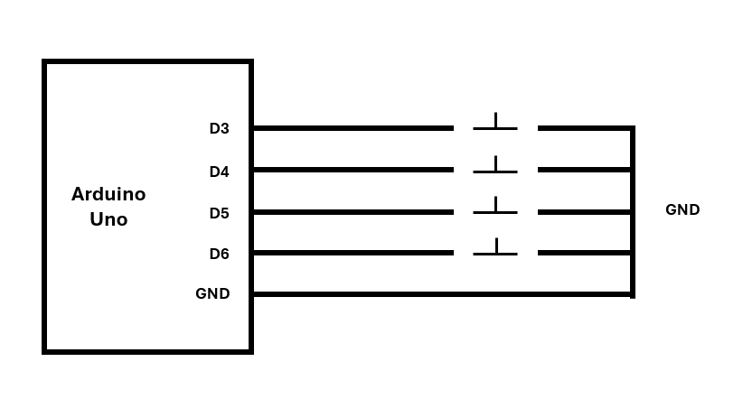
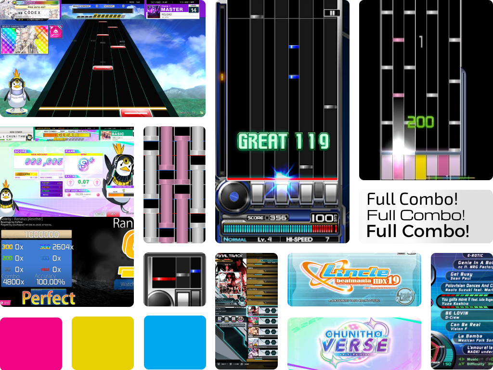
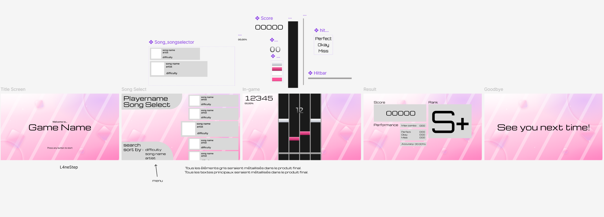
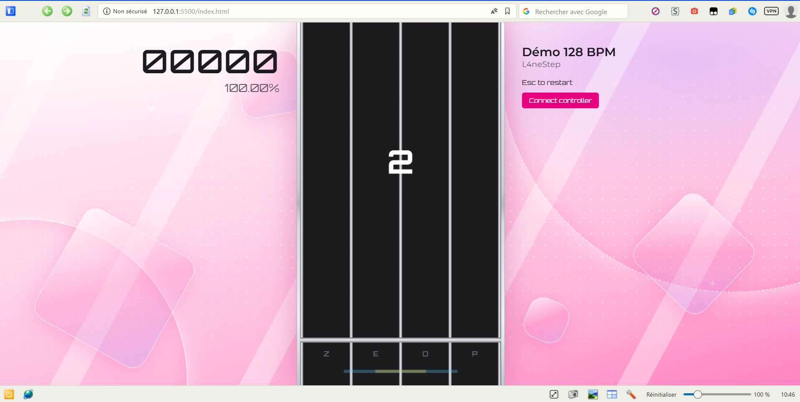

# L4neStep (jeu de rythme en 4 lane)

<picture>
    
</picture>

## Table des matières
- [Démarche et choix techniques](#Démarche-et-choix-techniques)
- [Code de la partie électronique↗](cwiot/Projet_manette.ino)
- [Schéma électronique](#Schéma-électronique)
- [Moodboard](#Moodboard)
- [UI figma](#UI-figma)
- [Code de la partie web↗](dww/index.html)
- [Vidéo](#Vidéo)

## Démarche et choix techniques

<ins>Mon investissement dans L4neStep</ins>

Déjà, pourquoi ce nom ? « L4ne », c’est le mot lane avec un 4 à la place du « a », parce que c’est un jeu de rythme en 4 lanes. « Step », c’est une référence à StepMania, l’un des jeux de rythme les plus connus, où l’on joue aussi sur 4 lanes en suivant les notes qui défilent.

Je me suis énormément investi dans ce projet, parce que pour une fois c’était un sujet qui me passionnait vraiment, comme toute cette majeure Management in Tech au final. Les jeux de rythme, c’est un genre que j’adore (moi qui joue à chunithm en salle d'arcade 😊: https://youtu.be/_N3CyItYkpY), et pouvoir en créer un avec ma propre manette, c’était le projet idéal pour moi. Je compte d’ailleurs le continuer après les cours, j'ai déjà des pistes d'amélioration.

L’idée : un jeu de rythme 4 lanes inspiré de CHUNITHM, IIDX, DDR, osu! mania.
La direction artistique : la moodboard et l’UI sur Figma, l’ambiance rose et argent métallique inspiré des jeux de rythme du débuts des années 2000.
La manette : construite avec un Arduino Uno et 4 boutons, protocole d’une lettre par message serial (majuscule = appui, minuscule = relâchement).

Comme ce projet me tenait à cœur, je n’ai pas voulu me limiter à ce qu’on voyait en cours. Dès le début de DWW, j'ai lu et vu énormément de documentation, de posts StackOverflow (je pense sincèrement que ce site est habité par le diable) et de tutos YouTube JavaScript pour comprendre comment faire un jeu dans navigateur, la boucle de rendu, la gestion du temps, le son, la communication avec l’Arduino. C’est pour ça, par exemple, que le jeu utilise directement ctx (l’API Canvas), on n’avait pas encore eu le cours sur p5.js, et plutôt que d’attendre, je suis allé chercher comment faire par moi-même.

<ins>Mon utilisation de l’IA</ins>

En revanche, je voulais que le jeu soit vraiment beau, à la hauteur de la direction artistique que j’avais imaginée sur Figma. Pour l’aspect visuel, j’ai donc demandé de l’aide à Claude, notamment pour trois éléments : le background animé, l’effet métallique sur les éléments du jeu, et les étincelles qui apparaissent quand on appuie sur les touches. Ce sont des effets plus avancés, qui demandent de bien maîtriser les dégradés et les animations sur Canvas. Je les ai intégrés au jeu, ajustés pour qu’ils collent à l’ambiance rose et argent que je voulais, et testés avec ma manette.

Je pense que ça complète vraiment le projet. Sans le background animé, ce n’est pas du tout le même rendu. C’est ce qui donne au jeu son côté vraiment vivant.

<ins>Pourquoi Canvas 2D ?</ins>

Quand j’ai commencé L4neStep, on n’avait pas encore eu le cours sur p5.js, donc le jeu utilise directement l’API Canvas du navigateur (ctx). Et au final, c’est un bon choix pour un jeu de rythme : des dizaines de notes bougent en même temps, au moins 60 fois par seconde. Déplacer autant d’éléments HTML serait lent et saccadé. Avec le Canvas, le jeu redessine tout à chaque image, dans une boucle qui fonctionne exactement comme draw() en p5, ce que j’ai bien compris quand on a vu p5 ensuite. C’est fluide, et je contrôle complètement le rendu : les dégradés argentés, le faisceau rose quand on appuie, l’éclair quand on touche une note.

<ins>Pourquoi la Web Audio API ?</ins>

Dans un jeu de rythme, le plus important, c’est que les notes tombent exactement sur la musique. Une simple balise '<audio>' n’est pas assez précise, son temps se met à jour par à-coups, et les notes se décalent petit à petit. La Web Audio API fournit une horloge audio très précise, qui tient compte du temps que met le son à sortir des enceintes. Les notes restent donc calées sur ce qu’on entend vraiment.

<ins>Pourquoi la Web Serial API ?</ins>

Je voulais le moins de latence possible entre ma manette et le jeu. Avec Web Serial, le navigateur lit directement ce que l’Arduino envoie par USB, sans passer par un programme intermédiaire. Et comme chaque message ne fait qu’une lettre, il y a très peu de données à envoyer et presque rien à traiter côté jeu.

## Schéma électronique
<picture>
    
</picture>

Ce prototype utilise une carte Arduino UNO, ainsi que 4 boutons-poussoirs montés en pull-up afin de gagner de la place en exploitant les résistances internes de l'arduino.

## Moodboard

<picture>
  
</picture>

## UI figma

<picture>
  
</picture>

https://www.figma.com/design/NVvjfoBUzp5LUpfCwLDBOt/Project?node-id=13-62&t=NsxD2xvsFILvnJrH-1

## Partie DWW
Voici une preview de mon projet. 

## Vidéo

[Voir la vidéo↗](https://youtu.be/D-IFhmlEWfQ)