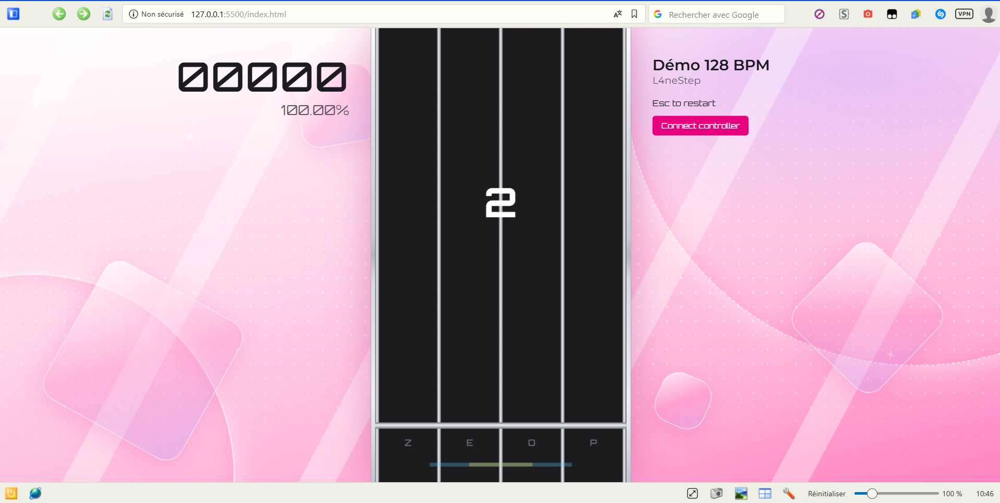

# L4neStep (jeu de rythme en 4 lane par Paul. M)

Voici la table des matières de mon rendu
- [Code of the electronic part↗](cwiot/Projet_manette.ino)
- [schematic view](#schematic-view)
- [Moodboard](#moodboard)
- [UI on figma](#figma-ui)
- [Code of the web part↗](dww/index.html)
- [Video](#video)

## schematic view
<picture>
    
</picture>

This prototype uses an Arduino UNO, along with 4 push buttons in a pull-down configuration to save space.

## Moodboard

<picture>
  
</picture>

## Figma UI

https://www.figma.com/design/NVvjfoBUzp5LUpfCwLDBOt/Project?node-id=13-62&t=NsxD2xvsFILvnJrH-1(images/figma_Ui.png)

## Web part
Here is a preview of the assignment. 

## Video

[See the video on youtube↗](https://youtu.be/D-IFhmlEWfQ)